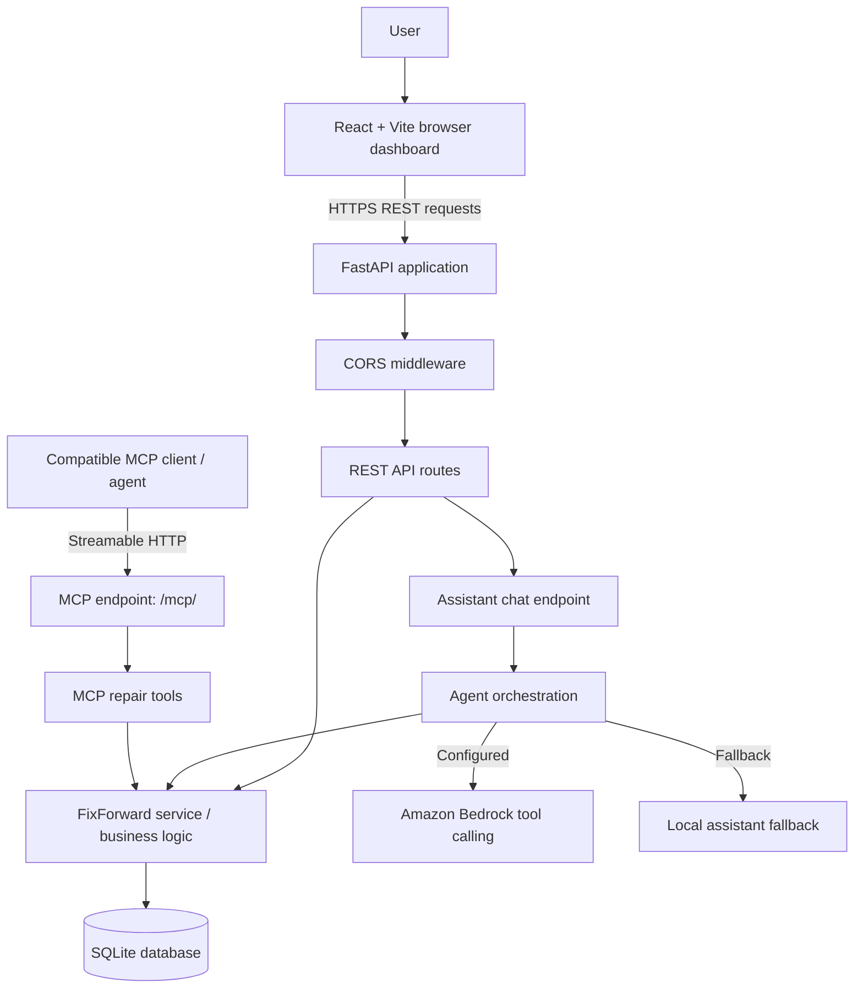

# FixForward AI

**The agent that gets things fixed.**

FixForward AI is an AI-assisted appliance repair coordination demo that brings troubleshooting, warranty checks, repair-case management, and appointment recovery into one workflow. It is built around a simulated washing-machine repair scenario for the **WhirlNest WashPro 8kg** appliance (`APL-1001`). A browser dashboard connects to a FastAPI backend, while a Streamable HTTP Model Context Protocol (MCP) endpoint exposes the same repair capabilities as tools for compatible agent clients.

> **Demo disclaimer:** Appliance, warranty, technician, and appointment records are simulated. FixForward AI does not contact a real repair company, verify manufacturer coverage, dispatch a real technician, or book real-world services. Troubleshooting information is guidance, not a confirmed diagnosis.

## Live demo

- **Web application:** https://fixforward-ai.vercel.app
- **Backend API:** https://fixforward-ai-api.onrender.com
- **Health check:** https://fixforward-ai-api.onrender.com/health
- **Interactive API docs:** https://fixforward-ai-api.onrender.com/docs
- **MCP endpoint:** https://fixforward-ai-api.onrender.com/mcp/

The root backend URL (`/`) may return `{"detail":"Not Found"}` because the API does not define a root route. Use `/health` to check the service and `/docs` to explore its REST API.

## Problem and approach

Appliance repair often involves several disconnected steps: understanding the symptom, checking warranty information, opening a service case, finding a suitable appointment, and recovering when an appointment is cancelled. FixForward AI demonstrates how these steps can be coordinated through a shared workflow and a consistent set of business operations.

The project focuses on:

- **Guided troubleshooting:** Retrieve safety-conscious first-line guidance for the selected appliance and reported symptoms.
- **Warranty lookup:** Show the saved demo warranty record while clearly distinguishing simulated data from a manufacturer's confirmation.
- **Repair-case lifecycle:** Create cases, inspect their status, and read their activity history.
- **Appointment coordination:** View available demo slots and book only after explicit user confirmation.
- **Appointment recovery:** Demonstrate a technician-cancellation event and reschedule a case that needs a new appointment.
- **Conversational assistance:** Provide an assistant chat endpoint that uses configured Bedrock tool calling when available and a local fallback otherwise.
- **Agent interoperability:** Expose repair functions through a Streamable HTTP MCP server.

## System design



### Main components

| Component | Responsibility |
|---|---|
| **React + Vite frontend** | Browser-based repair dashboard and conversational interface. It calls the backend using `VITE_API_BASE_URL`. |
| **FastAPI REST API** | Provides health information and endpoints for appliances, warranty, troubleshooting, cases, case history, status updates, slots, booking, cancellation simulation, rescheduling, and assistant chat. |
| **Service/business layer** | Keeps repair operations behind shared functions so REST routes and MCP tools use the same business logic. |
| **SQLite** | Stores demo repair cases and appointment/workflow state. The database is initialized when the backend application starts. |
| **Assistant/agent layer** | Uses Bedrock tool calling when configured; otherwise, the application can use its local fallback. Availability depends on backend configuration. |
| **MCP server** | Exposes repair functions to compatible clients through Streamable HTTP at `/mcp/`, mounted on the same FastAPI application. |
| **Hosting** | Frontend is hosted on Vercel and the Python API is hosted on Render. |

### Request lifecycle

1. A user selects the appliance or describes a repair issue in the browser dashboard.
2. The frontend sends a request to the FastAPI backend using `VITE_API_BASE_URL`.
3. The API validates the request and invokes the service layer.
4. The service layer reads or updates the SQLite-backed demo workflow and returns a structured result.
5. For conversational requests, the assistant may use configured Bedrock tool calling or the local fallback. Compatible external clients can invoke the same core capabilities through MCP.
6. The frontend presents the result, including when an action requires confirmation or when the data is only simulated.

## Safety and workflow rules

- **Booking requires explicit approval.** The booking and rescheduling operations must not be treated as confirmed until the user has approved the exact appointment slot and the operation reports a successful scheduled result.
- **No false real-world claims.** The app must not imply that it has contacted a service provider or completed a real booking.
- **Troubleshooting stays cautious.** Guidance is not a definitive diagnosis and should not direct users to open electrical panels or sealed components.
- **Demo data is disclosed.** Warranty, appliance, technician, and appointment information is simulated.

## Technology stack

- **Frontend:** React, Vite, JavaScript/CSS
- **Backend:** Python, FastAPI, Pydantic, Uvicorn
- **Agent integration:** MCP Streamable HTTP; optional Amazon Bedrock tool calling with local fallback
- **Persistence:** SQLite
- **Deployment:** Vercel (frontend), Render (backend)

Check `backend/requirements.txt`, `backend/README.md`, and the frontend `package.json` for the repository's precise dependency versions and commands.

## API overview

The backend's interactive OpenAPI documentation is available at [`/docs`](https://fixforward-ai-api.onrender.com/docs). The main routes are:

| Method | Endpoint | Purpose |
|---|---|---|
| `GET` | `/health` | Health check and agent/configuration status |
| `POST` | `/api/assistant/chat` | Send a conversational assistant message and optional history/context |
| `GET` | `/api/appliances` | List registered demo appliances |
| `GET` | `/api/appliances/{appliance_id}` | Retrieve appliance details |
| `GET` | `/api/appliances/{appliance_id}/warranty` | Retrieve demo warranty information |
| `GET` | `/api/appliances/{appliance_id}/troubleshooting?symptoms=...` | Search troubleshooting guidance (pass `symptoms` as a query parameter) |
| `GET` | `/api/slots` | List available demo appointment slots; optional `date` and `limit` parameters |
| `POST` | `/api/cases` | Create a repair case |
| `GET` | `/api/cases/{case_id}` | Retrieve case status and details |
| `GET` | `/api/cases/{case_id}/activity` | Read case activity events |
| `GET` | `/api/cases/{case_id}/history` | Read appointment history for a case |
| `POST` | `/api/cases/{case_id}/status` | Mark a case resolved or closed, subject to business rules |
| `POST` | `/api/cases/{case_id}/book` | Book a slot after explicit user confirmation |
| `POST` | `/api/cases/{case_id}/simulate-cancellation` | Trigger a demo technician-cancellation scenario |
| `POST` | `/api/cases/{case_id}/reschedule` | Reschedule a case after confirmation |
| `POST` | `/mcp/` | Streamable HTTP MCP endpoint for compatible MCP clients |

For exact request schemas and response examples, use the live API docs rather than guessing payloads.

## Run locally

### Prerequisites

- Python 3.11 or a compatible version supported by the backend dependencies
- Node.js and npm
- Git

### 1. Start the backend

From the repository root:

```bash
cd backend
python -m venv .venv
```

Activate the environment:

**Windows PowerShell**

```powershell
.venv\Scripts\Activate.ps1
```

**macOS/Linux**

```bash
source .venv/bin/activate
```

Install dependencies and start the API:

```bash
pip install -r requirements.txt
python server.py
```

By default, the server runs on `http://127.0.0.1:8000`. Visit `http://127.0.0.1:8000/health` for the health check and `http://127.0.0.1:8000/docs` for interactive API documentation. See [`backend/README.md`](backend/README.md) for backend-specific configuration and details.

### 2. Start the frontend

Open a second terminal from the repository root:

```bash
cd frontend
npm install
```

Create `frontend/.env.local` with the local API address:

```dotenv
VITE_API_BASE_URL=http://127.0.0.1:8000
```

Then start the Vite development server:

```bash
npm run dev
```

Open the local URL printed by Vite. If you change a Vite environment variable, restart the development server so it reads the updated value.

> Keep backend credentials in the backend environment only. Never put private API keys or cloud credentials in a `VITE_` variable, because frontend environment variables are bundled into browser-accessible code.

## Deployment

### Backend — Render

The deployed API is `https://fixforward-ai-api.onrender.com`.

- Configure the Render service to use the `backend` directory as its root if the service is configured around that subdirectory.
- Use a start command that launches the ASGI app in `server.py`, binds to `0.0.0.0`, and listens on Render's supplied `PORT`. The repository's `backend/README.md` and Render service settings should be treated as the source of truth for the configured command.
- Add required backend-only environment variables in Render according to the backend agent configuration. Do not expose secrets to the browser.
- Add the exact deployed frontend origin to `allow_origins` in `backend/server.py`, then redeploy the backend. The current CORS list must include the production Vercel domain for browser requests from that domain to work.
- **Persistence consideration:** SQLite data stored on an ephemeral host filesystem can be lost when the service is replaced or redeployed. For durable deployed workflow state, configure a persistent disk supported by your Render plan or move persistence to a managed database. Confirm the chosen hosting configuration before relying on saved cases across deployments.

### Frontend — Vercel

The deployed web application is `https://fixforward-ai.vercel.app`.

Set this environment variable in the Vercel **frontend project**:

```dotenv
VITE_API_BASE_URL=https://fixforward-ai-api.onrender.com
```

Apply it to the appropriate deployment environment and redeploy the frontend after changing it. The value is the API base URL only; do not append `/health` or `/docs`.

## Current project status

- [x] Streamable HTTP MCP server and shared business logic
- [x] Persistent SQLite-backed repair-case and appointment workflow locally
- [x] Explicit confirmation requirement for booking and rescheduling
- [x] Demo scenario for technician cancellation and appointment recovery
- [x] FastAPI REST endpoints for the browser application
- [x] Browser-based conversational demo and repair dashboard
- [x] Render backend and Vercel frontend deployments responding
- [ ] Comprehensive end-to-end testing of all user workflows
- [ ] Verify durable database persistence in the deployed hosting setup
- [ ] Expand evidence-grounded responses and evaluate assistant behavior
- [ ] Additional AWS service integration for the AWS Builder mini challenge
- [ ] Alexa+ onboarding/authentication configuration, if available to the project
- [ ] Record and validate the final hackathon demonstration

This status reflects the intended current development state and should be updated as each item is verified.

## Testing checklist

Before presenting or submitting the demo, verify the following using the live dashboard and API docs:

- [ ] `/health` returns a healthy response and `/docs` loads.
- [ ] The frontend can reach the Render API without CORS errors.
- [ ] Appliance details and warranty data load for `APL-1001`.
- [ ] Troubleshooting returns relevant guidance for a symptom query.
- [ ] A repair case can be created and retrieved.
- [ ] Available slots can be listed.
- [ ] Booking without confirmation does not falsely report a confirmed appointment.
- [ ] Booking with confirmation updates the case/appointment state appropriately.
- [ ] The technician-cancellation demo scenario transitions the case to a rescheduling state.
- [ ] Rescheduling requires confirmation and records the resulting state/history.
- [ ] Case activity and appointment history reflect the actions taken.
- [ ] The assistant works with the configured agent provider, and fallback behavior is understandable when provider credentials are absent.
- [ ] State persistence is checked across a backend restart/redeploy according to the selected storage configuration.

Use only demo data for hackathon demonstrations; do not enter real customer details or treat the simulated workflow as a real service booking.

## Repository layout

```text
fixforward-ai/
├── backend/
│   ├── server.py             # FastAPI routes and mounted MCP endpoint
│   ├── fixforward/           # Business logic, data access, and assistant modules
│   ├── data/                 # Local SQLite database location (if initialized here)
│   ├── requirements.txt      # Python dependencies
│   └── README.md             # Backend-specific setup and details
└── frontend/
    ├── package.json          # Frontend scripts and dependencies
    └── src/                  # React application source
```

File-level details may evolve as the project develops; use the repository itself as the source of truth for exact files and dependency versions.

## Hackathon context

FixForward AI is being developed incrementally for an Alexa+ hackathon submission. The current demo demonstrates a repair workflow through a browser dashboard, backend API, and MCP tool server. Alexa+ onboarding/authentication and any additional AWS service integration remain dependent on eligibility, access, and subsequent implementation; they should not be interpreted as completed integrations unless explicitly verified.

## License

Intended license: **MIT**. Ensure that a `LICENSE` file containing the MIT License text is present in the repository before describing the public release as MIT-licensed.
